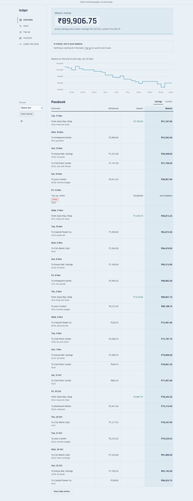

# ledger-service

A double-entry ledger service built with Node 22, TypeScript, Express and raw SQL on
Postgres 17. Every movement of money is a **transaction** made of **entries** (debits and
credits). The database itself guarantees the ledger's core rules. Entries are
append-only, every transaction balances at COMMIT, user balances never go negative, and
currencies can't be mixed. Application bugs therefore can't corrupt the books. Money is
always stored as integer paise (`BIGINT`). Step 1 sets up the schema, those guarantees,
their tests and a `/health` endpoint. See [docs/STEP-01-EXPLAINED.md](docs/STEP-01-EXPLAINED.md).

## Run it locally (Node 22 + Docker)

```bash
npm install
cp .env.example .env && cp .env.test.example .env.test
npm run db:up        # Postgres 17 in Docker; first start creates roles + databases
npm run migrate      # applies migrations/*.sql to the `ledger` database
npm test             # migrates + truncates `ledger_test`, then runs every test
```

If your database volume predates step 5, create the two new roles first:
`npm run db:roles` (safe to re-run), then `npm run migrate`.

Then `npm run dev` starts the API on http://localhost:3000. `GET /health` returns 200 when
the database is reachable.

## Scripts

| Script              | What it does                                                   |
| ------------------- | -------------------------------------------------------------- |
| `npm run db:up`     | Start Postgres and wait until it is healthy                    |
| `npm run db:down`   | Stop Postgres (data is kept in the `ledger_pgdata` volume)     |
| `npm run db:roles`  | (Re)create the database roles on an existing volume; idempotent |
| `npm run migrate`   | Apply new SQL migrations as `ledger_owner`                     |
| `npm run dev`       | Run the API with auto-reload                                   |
| `npm run demo:race` | Watch two concurrency bugs happen, then `transfer()` avoid them |
| `npm run demo:retry`| Send one transfer 5 times with one key, then with 5 keys        |
| `npm run demo:webhooks` | One top-up, confirmed 5 times plus one forged webhook       |
| `npm run provider`  | Run the mock payment provider + notification sink on port 4100 |
| `npm run worker`    | Run the outbox worker (several copies may run at once)         |
| `npm run reconcile` | Check the books; exit 1 and list problems if anything is off   |
| `npm run demo:outbox` | A top-up whose worker is killed mid-flight, then recovers    |
| `npm run build`     | Compile to `dist/` (what the container image runs)             |
| `npm run stack:up` / `stack:down` | Start / stop the full Docker stack           |
| `npm run k8s:up` / `k8s:down` | Create / delete the local Kubernetes cluster (kind) with everything deployed |
| `npm run k8s:smoke` / `k8s:zero-downtime` / `k8s:hpa-demo` | Prove the cluster works, rolls with 0 failed requests, autoscales |
| `npm run k8s:validate` | Render and schema-check the manifests without a cluster |
| `cd agent && uv run pytest` | The assistant service's tests, as `ledger_agent` (see below) |
| `npm run typecheck` | TypeScript type check, no output files                         |
| `npm test`          | Run the tests against the real `ledger_test` database          |

## API

### `POST /transfers`

Moves money between two accounts of the same currency. Safe to retry: send the same
`Idempotency-Key` and you get the first answer back instead of a second transfer.

| Header | Required | Meaning |
|---|---|---|
| `Idempotency-Key` | yes (1–255 chars) | Unique per intended transfer; reuse it on retries. Keys expire after 24 h. |
| `X-Client-Id` | yes | Who is calling. Keys are scoped per client. **A stand-in for authentication**, which a later step adds. |
| `Content-Type` | `application/json` | |

Body (no extra fields allowed):

```json
{ "fromAccountId": "<uuid>", "toAccountId": "<uuid>", "amountPaise": "2500", "note": "optional" }
```

`amountPaise` is a **string** holding a positive integer (`^[1-9][0-9]*$`) so the amount
never passes through a floating-point number.

**Limits per request** (one place: [src/limits.ts](src/limits.ts)): one transfer moves at most
**₹2,00,000.00** (`"20000000"`), one top-up asks for at most **₹1,00,000.00** (`"10000000"`).
Above that the answer is `400 amount_over_limit` with a message that names the limit; like any
invalid amount it is not stored under the key, so the key can be used again. `GET /limits`
returns both (`{ "topupMaxPaise": "10000000", "transferMaxPaise": "20000000" }`); the web app's
forms read them from there. Money an account already held when its history here begins is
not a request: it is an **opening balance** (transaction kind `opening`, migration 013),
double-entry from the bank settlement account, recorded only by `ledger_owner` (the seed).

```bash
curl -i -X POST http://localhost:3000/transfers \
  -H 'Content-Type: application/json' \
  -H 'X-Client-Id: demo' \
  -H "Idempotency-Key: $(uuidgen)" \
  -d '{"fromAccountId":"<uuid>","toAccountId":"<uuid>","amountPaise":"2500","note":"rent"}'
```

| Status | When |
|---|---|
| `201 { "transactionId": … }` | money moved (or, with `Idempotent-Replayed: true`, moved earlier under this key) |
| `400` | invalid body or amount, amount over the limit (`amount_over_limit`), same account, missing `Idempotency-Key` |
| `401` | missing `X-Client-Id` |
| `404` | an account does not exist |
| `409` + `Retry-After: 1` | the first request with this key is still running after 5 s (configurable) |
| `422` | insufficient funds, currency mismatch, or this key was already used for a different request |
| `500` | unexpected; nothing was stored, retry with the same key |

Errors look like `{ "error": { "code": "insufficient_funds", "message": "…" } }`.
See [docs/STEP-03-EXPLAINED.md](docs/STEP-03-EXPLAINED.md).

### `POST /topups` and `POST /webhooks/provider`: money coming in

A top-up is **not** credited when requested. It is credited when the payment provider
confirms it by a signed webhook. Locally the provider is `mock-provider/` (`npm run provider`).

```bash
# Terminals: database, API, mock provider (+ notification sink), outbox worker
npm run db:up && npm run migrate
npm run dev
npm run provider          # separate terminal; reads PROVIDER_PORT / WEBHOOK_SECRET / LEDGER_WEBHOOK_URL from .env
npm run worker            # separate terminal; calls the provider and delivers events (reads WORKER_* / PROVIDER_URL / NOTIFICATION_SINK_URL)

# 1. Ask for a top-up of ₹250.00 (same headers as /transfers). Nothing is credited yet.
curl -i -X POST http://localhost:3000/topups \
  -H 'Content-Type: application/json' -H 'X-Client-Id: demo' -H "Idempotency-Key: $(uuidgen)" \
  -d '{"accountId":"<user account uuid>","amountPaise":"25000"}'
#   202 { "topupId": "<uuid>", "status": "pending" }
#   The request did not call the provider; the worker does, within a second.

# 2. Find the provider's paymentId for it (recorded by the worker)
psql "$DATABASE_URL" -c "select provider_payment_id from topups where transaction_id = '<topupId>'"

# 3. Tell the mock provider the payment succeeded; it sends the signed webhook to the API
curl -X POST http://localhost:4100/payments/<paymentId>/succeed -H 'Content-Type: application/json' -d '{"times": 3}'
#   the API answers 200 { received: true, result: "posted" } once, then duplicate: true

# Try /fail then /succeed for an out-of-order pair, or any amount of times for duplicates.
```

| Status (POST /topups) | When |
|---|---|
| `202 { topupId, status: "pending" }` | top-up recorded and the provider call queued; money arrives by webhook |
| `400` | invalid body or amount; more than ₹1,00,000.00 (`amount_over_limit`, nothing stored) |
| `404` / `422` | unknown account; not a user account; currency with no settlement account |

| Status (POST /webhooks/provider) | When |
|---|---|
| `200 { received: true, result }` | applied (`posted`, `failed`) or recorded (`ignored_already_final`, `anomaly_amount_mismatch`, `unmatched`, `ignored_unknown_type`) |
| `200 { received: true, duplicate: true }` | this event id was already processed |
| `401` | signature missing, wrong, or timestamp outside the window; nothing stored |
| `400` | signed but not JSON / no event id; nothing stored, the provider retries |
| `500` | unexpected; everything rolled back, the provider retries |

`WEBHOOK_SECRET` must be the same value for the API and the provider. See
[docs/STEP-04-EXPLAINED.md](docs/STEP-04-EXPLAINED.md) and, for the worker and reconciliation,
[docs/STEP-05-EXPLAINED.md](docs/STEP-05-EXPLAINED.md).

## Run the full stack (Docker Compose)

Everything in containers: Postgres, migrations, API, outbox worker, mock payment
provider, Prometheus and Grafana. Separate from the dev database above (its own volume).
Uses about 300–450 MB of memory.

```bash
npm run stack:up        # build images, start everything, wait until healthy
```

| | |
|---|---|
| API | <http://localhost:3000> (`/healthz`, `/readyz`; `/metrics` is on internal port 9100, scraped by Prometheus) |
| Grafana | <http://localhost:3001>, dashboard **Ledger** (anonymous, read-only) |
| Prometheus | <http://localhost:9090> |
| Mock provider | <http://localhost:4100> |

On demand:

```bash
F="-f docker-compose.full.yml"
docker compose $F run --rm reconcile                          # check the books (exit 1 on problems)
docker compose $F run --rm -T seed > load/out/accounts.json   # 10 funded accounts for k6
docker compose $F run --rm k6                                  # 2-minute load test (K6_VUS, K6_DURATION)
load/outbox-drain-bench.sh 1 2 4 8                             # how fast the events lane drains per loop count
docker compose $F logs -f api worker                           # JSON logs; filter by request_id
npm run stack:down                                             # stop (add `-- -v` to delete the data)
```

The outbox worker runs as two services, one per lane: `worker-commands` (provider calls
a user is waiting on) and `worker-events` (notifications). Set loops per service with
`WORKER_COMMANDS_CONCURRENCY` / `WORKER_EVENTS_CONCURRENCY` (defaults 1 and 4). Events are
delivered at least once and **unordered**; consumers sort by `sequence` (see step 6a.1).

`npm run build` compiles to `dist/` (what the image runs). See
[docs/STEP-06A-EXPLAINED.md](docs/STEP-06A-EXPLAINED.md) for health vs readiness,
metrics, logs and the load-test results.

## The assistant service (`agent/`, step 7)

A separate Python 3.12 program (FastAPI, psycopg 3, `uv`) that reads the ledger as the
database role `ledger_agent`: SELECT on four views only, every row filtered by Postgres
row-level security to the client of the request. Step 7a is the fence (ownership, role,
views, three read-only tools); the model comes in 7b.

```bash
cd agent
uv sync                      # Python 3.12 + locked dependencies (needs uv: https://docs.astral.sh/uv/)
uv run pytest                # against ledger_test (migrated by `npm test`), as ledger_agent
uv run ruff check . && uv run ruff format --check . && uv run mypy
uv run uvicorn ledger_agent.api:app --port 8000      # AGENT_DATABASE_URL from the environment
```

Accounts now belong to a client: `POST /transfers` and `POST /topups` answer 404 for an
account the caller does not own, exactly like a missing one. See
[docs/STEP-07A-EXPLAINED.md](docs/STEP-07A-EXPLAINED.md).

**Step 7b: `POST /ask`.** Questions about your own money and about the (fictional) policies,
answered by Gemini through LangChain/LangGraph, every figure verified by code against the
data the tools fetched. Needs a Gemini key in `agent/.env` (`cp agent/.env.example agent/.env`;
never committed) and the policies embedded once:

```bash
npm run db:roles                                      # also creates pgvector (superuser), safe to re-run
npm run migrate
cd agent
uv run python scripts/ingest_policies.py              # idempotent; --dry-run to preview
uv run uvicorn ledger_agent.api:app --port 8000
curl -s localhost:8000/ask -H 'X-Client-Id: <client>' -H 'content-type: application/json' \
  -d '{"question": "Why is my balance lower than last week?"}'
uv run python scripts/smoke_real_model.py             # 3 questions against the real model
```

At most 20 questions per client per 24 hours (429). Compose: `GOOGLE_API_KEY` in the repo's
`.env`, then `docker compose -f docker-compose.full.yml run --rm agent-ingest`. A compose
volume created before step 7b lacks pgvector: run the roles file once against it
(`docker compose -f docker-compose.full.yml exec -T postgres psql -U postgres -d postgres -f - < k8s/base/postgres/init/00-roles.sql`).
See [docs/STEP-07B-EXPLAINED.md](docs/STEP-07B-EXPLAINED.md).

**Step 7c: the eval.** 50 items (40 questions + 10 prompt-injection attempts) against a seeded
ledger, expected answers from plain SQL, reported as counts. It calls the real model, so it
never runs in CI, and it is built for the free tier: it throttles, stops at a budget, resumes,
and backs off on 503s without counting them as wrong answers.

```bash
cd agent
uv run python -m eval.run --label baseline --estimate          # what a run costs; no API calls
uv run python -m eval.run --label baseline --daily-budget 400  # 50 x 3; re-run to resume
uv run python -m eval.run --label e1 --subset --features prefetch   # 20 x 2, one change switched on
uv run python -m eval.report baseline@subset e1                # BEFORE / AFTER, in counts
uv run python -m eval.trace_latency baseline                   # model / tool / our code, from LangSmith
uv run python -m eval.langsmith_upload baseline                # dataset + experiment (no model calls)
```

The improvements are switches (`AGENT_FEATURES=prefetch,answer_tool,...`), so each one is
measured on its own. See [docs/STEP-07C-EXPLAINED.md](docs/STEP-07C-EXPLAINED.md).

## The web app (`web/`, step 7d)

A demo front end for recruiters and engineers: pick a fictional person, see their passbook,
send money and then the same request again (it moves nothing), follow a top-up from
"202 Accepted" to the signed webhook, ask the assistant, and run 200 concurrent transfers
followed by reconciliation. The browser only talks to the Next.js server, which adds
`X-Client-Id` itself; client ids and internal URLs never reach the page.



```bash
npm run seed:demo                     # the demo people (as ledger_owner, idempotent)
npm run demo:reset                    # start the demo over: demo clients only, in one transaction
npm run demo:check                    # every demo balance as seeded, and the ledger reconciles
cd web && npm ci && npx next build
npx playwright test --project=flows   # starts the API, worker, mock provider and web itself
npm run screenshots                   # docs/images/web/, desktop + phone, light + dark
npm run lighthouse                    # accessibility, fails below 95
```

Compose: `docker compose -f docker-compose.full.yml run --rm seed-demo`, then
`docker compose -f docker-compose.full.yml up -d web`, then open http://localhost:3200.
The assistant page runs a script over the person's live data by default
(`ASSISTANT_MODE=fixtures`, no model call); `ASSISTANT_MODE=agent` uses the real assistant.
See [docs/STEP-07D-EXPLAINED.md](docs/STEP-07D-EXPLAINED.md).

## Run it on Kubernetes (locally, with kind)

The same images on a one-node Kubernetes cluster inside Docker. Needs `kubectl`, `kind`
(`brew install kind`) and about 1.5 GB of Docker memory. Manifests are plain kustomize
(`k8s/base` + `k8s/overlays/kind`); Secrets come from your `.env` and are never committed.

```bash
npm run k8s:up             # create the cluster, build + load images, Secrets, apply, wait
npm run k8s:smoke          # a transfer, a top-up, metrics internal, NetworkPolicies, reconcile
npm run k8s:zero-downtime  # k6 in the cluster while the api is rolled: failed requests = 0
npm run k8s:hpa-demo       # scale the api 2 -> 4 under load and back
scripts/k8s/reconcile-now.sh                                   # run the nightly CronJob now
kubectl --context kind-ledger -n ledger port-forward svc/grafana 3001:3000   # http://localhost:3001
npm run k8s:validate       # render + schema-check the manifests (what CI runs; no cluster)
npm run k8s:down           # delete the cluster
```

See [docs/STEP-06B-EXPLAINED.md](docs/STEP-06B-EXPLAINED.md) for what every object and
setting is for, the zero-downtime and HPA results, and why production uses a managed database.
The assistant runs there too (2 replicas, reachable only from pods labelled `app=web`); its
keys go into the Secret `agent-secrets` from `agent/.env`, and `SKIP_AGENT_INGEST=1` defers
embedding the policies when the day's quota is spent. A restart of the kind node container
loses the cluster (etcd lives in memory); `npm run k8s:down && npm run k8s:up` rebuilds it.

## Port 5432 already in use?

If another Postgres already listens on 5432, set `POSTGRES_PORT=5434` (or any free port) in
`.env`, and change `5432` to that port in the URLs in `.env` and `.env.test`.

## Back up the dev database before any risky change

Docker volumes live inside Docker's own disk image, and nothing backs them up. Before
anything that could lose data, dump the `ledger` database to the Mac's disk. Risky changes
include a Docker update, reset or cleanup, `down -v`, an untested migration, and a long eval
run.

```bash
mkdir -p backups                                    # git-ignored
docker compose exec -T postgres pg_dump -U postgres -d ledger -Fc \
  > backups/ledger-$(date +%Y%m%d-%H%M).dump
ls -lh backups/                                     # a 0-byte file means the dump failed
```

To restore into an empty volume, run `npm run db:up` first (it creates the roles), but not
`npm run migrate`: the dump already contains the schema and the migrations table.

```bash
docker compose exec -T postgres pg_restore -U postgres -d ledger --exit-on-error \
  < backups/ledger-YYYYMMDD-HHMM.dump
```

On macOS, also check that Docker's disk image is really there and not deleted while still
open. The first command must list the file; the second must print nothing:

```bash
ls -lh ~/Library/Containers/com.docker.docker/Data/vms/0/data/Docker.raw
lsof +L1 | grep -i docker.raw
```

Never delete `Docker.raw` by hand. Docker keeps using a deleted disk until it restarts,
then starts again with an empty one.

## Resetting the database

`k8s/base/postgres/init/00-roles.sql` creates the roles and databases. Docker runs it **only when the
data volume is empty**. If you change that file, or want a completely fresh database,
delete the volume:

```bash
npm run db:down -- -v   # same as: docker compose down -v  (deletes all local data)
npm run db:up
npm run migrate
```

**After any Docker reset** (a new volume, or Docker Desktop wiped its data) the `ledger`
database is empty again. Always run:

```bash
npm run db:up && npm run migrate
```

`npm test` migrates `ledger_test` by itself, but `npm run dev` needs `ledger` migrated.
