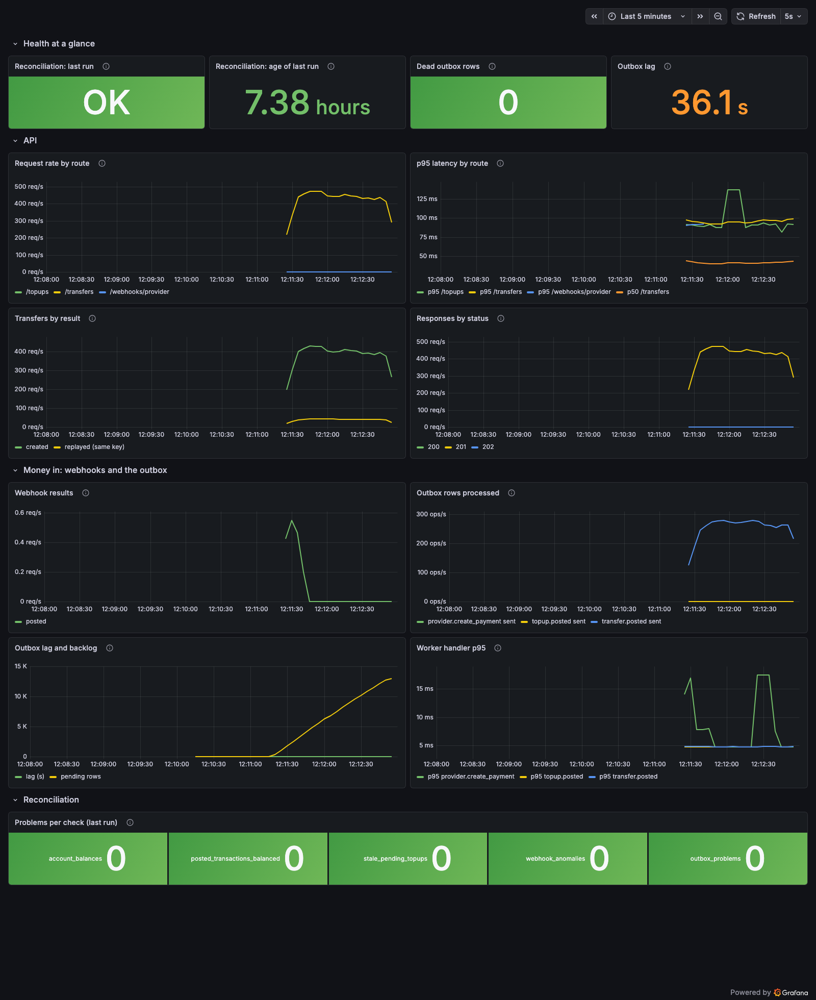

# Step 6a, explained: containers and observability

Step 6a packages the ledger into containers and makes it observable: health and
readiness probes, graceful shutdown, Prometheus metrics, JSON logs that share one
request id across services, a Grafana dashboard, and a load test whose results are
below. Everything runs locally with `docker-compose.full.yml`; step 6b moves it to
Kubernetes.

---

## 1. Containers

### One image, many commands

The ledger has four programs: the API, the outbox worker, the reconciliation job and
the migration runner. They share almost all their code, so they share **one image**
and differ only in the command:

| Service | Command |
|---|---|
| api | `node dist/src/server.js` |
| worker | `node dist/src/worker/main.js` |
| reconcile | `node dist/src/reconcile/main.js` |
| migrate | `node dist/scripts/migrate.js` |

One image means one build, one vulnerability scan, one version to roll out, and no
chance of the worker running different ledger code from the API.

### The multi-stage Dockerfile

```
deps        npm ci (ALL dependencies: TypeScript is needed to compile)
build       tsc -> dist/   (plain JavaScript)
prod-deps   npm ci --omit=dev (only what runs in production)
runtime     node:22-alpine with npm, npx, yarn, corepack deleted
app         runtime + prod node_modules + dist/ + migrations, USER node
```

Each stage starts from a clean slate and copies only what it needs from the previous
ones. The compiler, Vitest, tsx and every dev dependency stay in the build stages and
never reach the final image.

- **Non-root.** The app runs as `node` (uid 1000). Its files belong to `root` and are
  only readable, so even a compromised process cannot rewrite its own code.
- **No package managers at run time.** Nothing in production needs `npm`. Every binary
  we leave out is one we never have to patch.
- **`node`, not `npm start`.** On Linux, `npm`/`npx` do not pass SIGTERM on to the
  program (that is exactly how step 5's CI broke). The image runs `node` directly, so
  the stop signal from Docker or Kubernetes reaches the code that handles it.
- **No secrets, no `.env`.** `.dockerignore` keeps env files, tests, docs and git out
  of the build context. Configuration arrives at **run time** as environment variables.
  The images were scanned: no `.env` file and none of our local passwords or secrets
  anywhere on their filesystems.

### Sizes

| Image | On disk | Compressed (what a registry stores) |
|---|---|---|
| `ledger-service:local` | 177 MB | 69 MB |
| `ledger-mock-provider:local` | 164 MB | 65 MB |

Almost all of it is the Node 22 Alpine base (~160 MB). Our code plus production
dependencies add about **13 MB**. The mock provider was rewritten on `node:http` with
**no dependencies at all**: its image is Node plus four compiled files.

### The compose stack

`docker-compose.full.yml` starts postgres → **migrate** (runs once, exits 0) → api and
worker (they wait for migrate to *succeed*), the mock provider, Prometheus and Grafana.
Every service has a memory limit; with the whole stack idle it used about **305 MB**, and
about **450 MB** at 425 requests/s.

---

## 2. Health vs readiness

Two different questions, two endpoints:

| | `/healthz` (liveness) | `/readyz` (readiness) |
|---|---|---|
| Question | Is this process alive? | Should it receive work **right now**? |
| Checks | nothing: if it answers, it is alive | database answers `SELECT 1`, every migration file is applied, not shutting down |
| Failing means | **restart** the container | **stop sending traffic** to it (do not restart) |

**Why `/healthz` must not touch the database.** If the database goes down for a minute
and liveness depended on it, Kubernetes would restart every healthy API pod at once,
then restart them again, and the database coming back would meet a stampede. The pods
are fine; they just cannot do useful work. That is what readiness is for.

**Why "migrations up to date" is part of readiness.** During a deploy, new code can
start before the migration that adds its column has run. Until `schema_migrations`
lists every file the code ships with, the pod says "not ready" and gets no traffic.
(Migration 006 grants the app and worker `SELECT (filename)` on `schema_migrations` for
exactly this.)

The worker has no API, but it runs a tiny `node:http` server on port 9101 with the same
`/healthz`, `/readyz` and `/metrics`.

### Graceful shutdown

When Kubernetes (or `docker stop`) wants a container gone, it sends **SIGTERM**, waits
a grace period, then sends SIGKILL. The API uses that window:

1. `/readyz` turns **503**: the load balancer stops routing new requests here
2. `server.close()`: stop accepting new connections
3. close idle keep-alive connections; busy ones get `Connection: close` on their response
4. let in-flight requests finish (cap: `SHUTDOWN_GRACE_MS`, 25 s; compose waits 30 s)
5. close the database pool, exit 0

Test 2 in `tests/observability.test.ts` holds an account row locked so a transfer is
stuck mid-flight, sends SIGTERM to the real API process, and checks that new connections
are refused, the stuck transfer still completes with 201, and the process exits 0. The
worker does the same thing at row granularity (step 5): finish the current row, take no
new one.

---

## 3. Why the migration runner takes an advisory lock

Kubernetes may start several pods at once, each running migrations on start-up. Two
runners reading `schema_migrations` at the same moment both see "002 not applied" and
both run it: the second one crashes on `CREATE TABLE … already exists`, or worse,
applies a non-idempotent change twice.

So the runner takes a **Postgres advisory lock** first:

```sql
SELECT pg_try_advisory_lock(727201406);   -- got it? go
SELECT pg_advisory_lock(727201406);       -- otherwise wait here
... read schema_migrations, apply each new file in its own transaction ...
SELECT pg_advisory_unlock(727201406);
```

An advisory lock is a lock on a *number* rather than a row: it means whatever the
application agrees it means. It is **session-level**, so it is held across the
per-file transactions, and if the runner crashes, its connection drops and Postgres
releases the lock automatically: no stale lock files. The second runner waits, then
reads `schema_migrations` *after* getting the lock, finds everything applied, and
exits. `tests/migrations.test.ts` starts two runners on a slow probe migration at the
same instant and checks it is applied exactly once.

---

## 4. Metrics

Prometheus **pulls** `/metrics` from the API and the worker every 5 seconds and stores
each number as a time series. There are three kinds of metric:

| Type | What it is | Ours |
|---|---|---|
| **Counter** | only goes up (resets to 0 on restart); you look at its *rate* | `http_requests_total`, `ledger_transfers_total{result}`, `idempotency_replays_total`, `webhook_events_total{result}`, `outbox_rows_processed_total{type,outcome}` |
| **Gauge** | a value that goes up and down; you look at it *now* | `outbox_lag_seconds`, `outbox_pending_rows`, `outbox_dead_rows`, `reconciliation_last_run_ok`, `reconciliation_last_run_problems{check}` |
| **Histogram** | counts observations into buckets (≤5 ms, ≤10 ms, …, ≤10 s) so percentiles can be estimated later | `http_request_duration_seconds`, `outbox_handler_duration_seconds` |

Two kinds of gauge:
- **Measured in the process**: counters and histograms update as requests and rows are
  handled.
- **Queried at scrape time**: outbox lag, pending and dead rows, and the last
  reconciliation result live in the database, so the worker runs a small query whenever
  Prometheus scrapes it. That keeps them correct even with several workers or after a
  restart.

**Reconciliation metrics come from the worker.** The reconcile job is a CronJob that
exits after a fraction of a second, so there is nothing for Prometheus to scrape. Its
result is already stored in `reconciliation_runs`, so the worker, the long-running
background process, reports the latest row. Migration 006 grants it
`SELECT (id, ran_at, ok, summary)` only: the headline numbers, not the problems list.
"Never ran" is reported as **no sample at all** (Grafana shows "never ran"), not as 0,
because 0 means "the last run found problems".

### Why labels must be low-cardinality

Every distinct combination of label values is a **separate time series**, stored and
indexed forever. `route="/transfers"` is one series. If we labelled by account id, every
account would become a series per status code per method: a million accounts, millions of
series, and Prometheus runs out of memory. Same for request ids, idempotency keys or raw
URLs (`/accounts/7f3a…` is a new series per account).

Our rule: **every label value comes from a small fixed set**. Route *patterns* from
Express (`/transfers`; unknown paths become `unmatched`), status codes, our own result
codes, outbox types, check names. Test 4 asserts that `/metrics` contains no UUID, no
idempotency key, and only known route patterns. Per-request detail belongs in **logs**.

---

## 5. Logs and the request id

Every process logs **JSON lines** to stdout (pino); Docker and Kubernetes collect stdout.
JSON means a log system can filter on fields (`request_id = …`, `level = error`) instead
of grepping text.

### One id, end to end

```
client --X-Request-Id--> API --(AsyncLocalStorage)--> enqueueOutbox
                                                        payload.requestId
worker reads the row --> runs the handler under the same id --X-Request-Id--> sink / provider
```

- The API takes `X-Request-Id` from the client if it is short and safe
  (`[A-Za-z0-9._-]`, ≤128 chars), otherwise generates a UUID, and echoes it back.
- An **AsyncLocalStorage** (built into Node) holds it for the whole request, so every log
  line and every outbox row written during that request gets it without passing it
  through every function.
- The worker runs each row's handler under the id stored in its payload, and forwards it
  as `X-Request-Id` to the provider or the notification sink.

From the load test, one transfer followed across three services by its id:

```
[api]    {"service":"api","request_id":"k6-4-2270-…","result":"created","transaction_id":"b30f9c26-…","msg":"transfer"}
[api]    {"service":"api","request_id":"k6-4-2270-…","method":"POST","route":"/transfers","status":"201","duration_ms":114,"msg":"request"}
[worker] {"service":"worker","request_id":"k6-4-2270-…","outbox_id":"45956","type":"transfer.posted","outcome":"sent","msg":"outbox row handled"}
[mock-provider] {"service":"mock-provider","request_id":"k6-4-2270-…","outbox_id":"45956","type":"transfer.posted","msg":"notification received"}
```

### What is never logged

Secrets, the `Provider-Signature` header, raw webhook bodies. A rejected webhook logs
*why* (`signature_mismatch`, `missing_header`) and its size, nothing else; an accepted
one logs event id, type, payment id and result. pino's `redact` list is a safety net on
top, not the rule. Test 7 checks that neither the genuine nor a forged signature, nor the
secret, nor anything from inside the body, appears in the logs.

---

## 6. Reading the dashboard

Grafana at <http://localhost:3001> opens on the **Ledger** dashboard (anonymous,
read-only).

- **Health at a glance**
  - *Reconciliation: last run*: OK / PROBLEMS / never ran.
  - *Age of last run*: should match the reconcile schedule (a CronJob in step 6b).
  - *Dead outbox rows*: must be 0; anything else needs a person.
  - *Outbox lag*: how long the oldest due side effect has been waiting.
- **API**
  - *Request rate*, *p95 latency* (and p50 for transfers), *Transfers by result*
    (new transfers vs replays), *Responses by status*.
  - 4xx are business answers; **5xx should always be 0**.
- **Money in: webhooks and the outbox**
  - *Webhook results*, *Outbox rows processed* (sent / retry / dead by type),
    *Outbox lag and backlog* (lag on the left axis, pending rows on the right),
    *Worker handler p95*.
- **Reconciliation**: problems per check from the last run. All zeros = the books
  balance.

A p95 is an **estimate**: Prometheus interpolates inside the histogram bucket the
percentile falls in, so "93 ms" means "between the 50 ms and 100 ms buckets, about 93".



*Taken about 100 s into the load test. (The lag/backlog panel then shared one axis;
it has since been split so the lag in seconds is readable next to 13,000 rows.)*

---

## 7. The load test, in plain English

**Setup.** The full stack on this laptop (8 GB Mac, Docker limited to 3.8 GB, everything
in one VM). Ten accounts seeded with ₹1,00,000 each through proper posted top-ups.
k6 ran for **2 minutes**:
- **20 virtual users** sending transfers non-stop between random pairs of those
  accounts, each with a fresh `Idempotency-Key`. About **10 %** of them immediately
  resent the *same* request with the *same* key, as a client would after a lost
  response.
- In parallel, **one top-up per second** through the real flow: `POST /topups` → the
  worker asks the provider → the provider confirms → a signed webhook posts it.

**Results.**

| | |
|---|---|
| Transfer requests | **50,681**, **0 % failed** |
| Throughput | **425 requests/s** (≈ 385 new transfers/s plus retries) |
| Latency, transfers | p50 **39.7 ms** · p90 75.6 ms · p95 **93.3 ms** · p99 **154.6 ms** · max 598.5 ms |
| Same-key retries | **4,653** sent, **0 mismatches**: every one got the stored response back, money moved once |
| Insufficient funds | 0 (the accounts were funded generously) |
| Top-ups | 119 started; **only 9 confirmed** within k6's 5-second wait (see below) |
| Outbox afterwards | 46,028 + 119 + 9 rows delivered, **0 dead**, backlog drained 17 s after the load stopped |
| **Reconciliation after the test** | **OK: 0 problems** across 46,047 posted transactions and 92,094 entries |

In plain English: under a sustained 400+ requests per second, with constant contention
on just ten accounts, every transfer was answered, nine out of ten within 76 ms, no
request failed, every retry was safely deduplicated, and afterwards the books balanced to
the paisa.

### What the test found

**1. One worker cannot keep up with this many transfers.** The API wrote ~385
`transfer.posted` rows per second; one worker, handling one row per transaction (the
step 5 design), managed ~270/s. The backlog grew to about **13,000 rows** and the lag
reached **36 s**. Nothing was lost (it is a queue, and it drained in 17 s once the load
stopped), but notifications arrived half a minute late. The log trail above shows it:
the transfer was logged at 06:43:12, its notification sent at 06:43:46.

**2. Head-of-line blocking.** The outbox is one first-in-first-out queue. The 119
`provider.create_payment` commands (each one a user waiting at a "top-up in progress"
screen) sat **behind** thousands of notifications. k6 waited 5 s for each payment to be
created, gave up on 110 of them, and those top-ups are still `pending`. That is correct
and safe (no money moved), and reconciliation will flag them as stale after 24 h. But a
user-facing command should never wait behind a bulk notification.

What would fix them, for a later step (not built here):
- **More workers.** `FOR UPDATE SKIP LOCKED` already lets several workers share the
  queue safely; the outbox lag metric is exactly the signal an autoscaler would use.
- **Separate lanes.** Poll commands (`provider.*`) before events, or run separate
  workers per type, so payments are never stuck behind notifications.
- **Batching or leasing** (described in step 5) to cut the per-row transaction cost.

---

## 8. Eight questions to answer before moving on

1. A pod's `/healthz` returns 200 but its `/readyz` returns 503. What will Kubernetes do and not do, and name two situations that cause exactly this.
2. Why would making `/healthz` check the database turn a one-minute database outage into a much longer one?
3. Walk through the API's shutdown sequence. What happens to a request that arrives one millisecond after SIGTERM, and to one that arrived one millisecond before?
4. Two pods start the migration runner at the same instant. Trace both through the advisory lock. What happens if the first one crashes halfway through file 003?
5. For each of these, say counter, gauge or histogram, and why: transfers created; rows waiting in the outbox; time to answer a request; whether the last reconciliation passed.
6. Someone adds `account_id` as a label on `ledger_transfers_total`. What happens to Prometheus as the business grows, and where should per-account detail go instead?
7. Follow one transfer's request id from the client to the notification. Which component stores it where, and why does the worker not simply generate a new one?
8. The load test showed 36 s of outbox lag and 110 unconfirmed top-ups. Explain the two causes, why no money was at risk, and which metric you would alert on.
