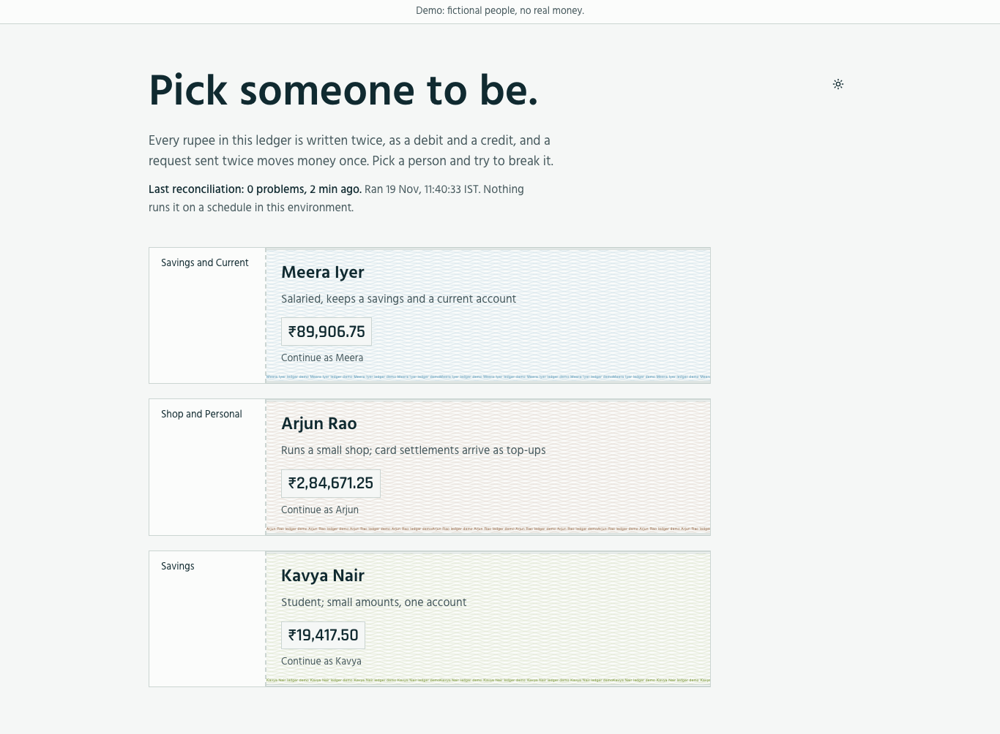
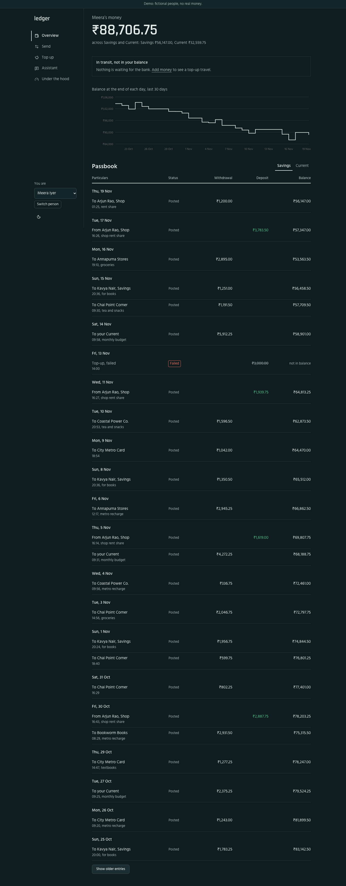
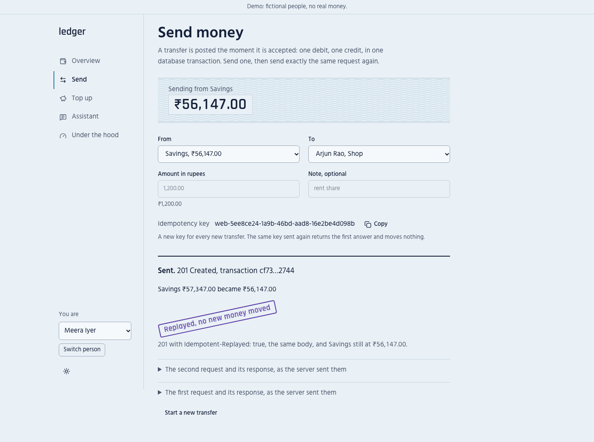
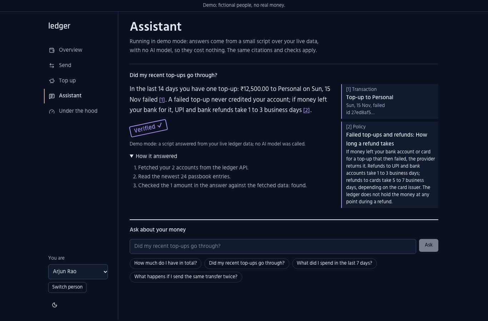

# Step 7d, explained: a face for the ledger

Steps 1 to 7c built a ledger that is correct, safe and observable, and an assistant that
cannot lie about money. None of it could be *seen*. Step 7d is a web app whose job is to
let a recruiter or an engineer understand that in thirty seconds, and then try to break it.

```
src/http/reads.ts                    owner-scoped reads: accounts, the passbook, balance history, a top-up's timeline
src/system/service.ts                outbox lanes, reconciliation, the chaos slot: on the API's INTERNAL port
migrations/011_system_actions.sql    the cooldown for "reconcile now" and the chaos test, shared by every replica
scripts/seed-demo.ts                 three fictional people, shops, a chaos pair, 30 days of history
web/                                 Next.js 16: pages, route handlers, Playwright tests
web/lib/server/                      everything only the web SERVER may do (client ids, internal URLs)
k8s/base/web/                        Deployment, Service, NetworkPolicy: the only public entry point
docs/images/web/                     every screen, desktop and phone, light and dark
```

| | |
|---|---|
|  |  |
|  |  |

---

## 1. Design decisions, and why

**A passbook, not a dashboard.** An Indian bank passbook is the most familiar picture of
money in this market, and it is exactly what an engineer trusts: dated rows with
Withdrawal, Deposit and a running Balance, where every line can be checked against the
one above it. The transaction list *is* a passbook, grouped by day. The running balance
comes from the API (the sum of the account's entries, the same rule reconciliation
checks), so the page shows the ledger's own arithmetic, not the browser's.

**The balance dominates; pending is never mixed with posted.** The total is the largest
thing on the screen. A top-up waiting for the bank is not in it: it sits in its own
"In transit, not in your balance" strip, amber *and* hatched (never colour alone), and in
the passbook it says "not in balance" where the balance would be. A failed top-up stays in
the passbook, struck through, so nobody wonders where it went.

**One loud element: the rubber stamp.** The violet of a bank's ink stamp appears only
where the system *proves* something: "Verified ✓" on an answer, "Replayed, no new money
moved" on a repeated request, "0 problems" after reconciliation. It lands once, when your
own action caused it, and not at all with reduced motion. Everything else is quiet: one
type family (Hind, from the Indian Type Foundry, which has a real ₹ glyph), Rajdhani's
squared digits only for the balance, tabular figures for every amount so columns line up
digit under digit, and Indian grouping everywhere (₹1,24,560.50, never "1.2 lakh").

**Show the internals engineers trust.** The Send page prints the idempotency key and, after
sending, the exact request and response the server exchanged with the ledger, including the
`Idempotent-Replayed` header. The top-up page is a five-step timeline from "202 Accepted,
nothing credited yet" to the signed webhook. "Under the hood" shows the outbox lanes and
the five reconciliation checks by name.

**Every claim is true for the environment it runs in.** The pages never say "reconciled
every night" from habit. They read the last recorded run ("Last reconciliation: 0 problems,
4 min ago") and mention a schedule only when `RECONCILE_SCHEDULE` says one exists. It is set
in Kubernetes, where a CronJob runs at 02:00 in `Asia/Kolkata`, and nowhere else. Compose has
no such job, so the page there says "Nothing runs it on a schedule in this environment."
Likewise "Grafana is not linked in this environment" when no URL is configured, and the
top-up timeline says "the time it happened is not recorded" for the one step whose time the
API cannot see (by design, it cannot read the outbox).

**The assistant costs nothing in the demo, and says so.** While the eval owns the Gemini
quota, the Assistant page runs in `fixtures` mode: a small script answers four kinds of
question **from the person's live data** (recorded text would stop being true the moment
they sent money), cites the accounts, transactions and policy sections it used, and checks
every amount in its answer against what it fetched, the same rule as the real verifier. The
page says plainly: "a script answered from your live ledger data; no AI model was called."
The policy sections it quotes live in `policies.json`, and CI fails if any of them drifts
from `agent/policies/` by a single word. With `ASSISTANT_MODE=agent` the same page talks to
the real assistant.

**Real states, not just the happy path.** Every page has an empty state that says what to do
("Nothing is waiting for the bank. Add money to see a top-up travel."), a loading state, and
errors that say what happened without apologising ("The ledger API did not answer…").

## 2. Why the browser never sees `X-Client-Id`

`X-Client-Id` is the ledger's stand-in for authentication: whoever sends it *is* that client.
If the browser held it, anyone could open the developer tools, change one header, and spend
someone else's money. (The API would still refuse spending from an account you do not own,
but you would now *be* the other client.) So:

- The cookie holds only the persona's **key** (`meera`), signed with HMAC so it cannot be
  edited into `arjun`. It is `httpOnly`: page scripts cannot read it.
- The client id (`demo-meera`) is looked up **on the web server** (`lib/server/identity.ts`)
  and added to server-to-server requests in `lib/server/ledger.ts`, the only module that
  talks to the ledger. That module imports `server-only`: if any browser code ever imported
  it, the build would fail.
- The browser only ever calls the web server's own routes (`/api/transfers`, `/api/ask`, …).
  Internal URLs (the API, its internal port, the assistant, the mock provider) are in
  server-side environment variables and never reach the page.

A Playwright test proves it on every run: it records every request the browser makes and
every response it receives across all six screens, and fails if a request carries
`X-Client-Id` or any response contains a client id. Another test edits the cookie by hand
and is sent back to the picker.

This also matches the network: the assistant's NetworkPolicy (7c) admits only pods labelled
`app=web`, and the web app's own policy lets it reach only the API, the assistant, the mock
provider and DNS. It is the one public entry point; on k3s (6c) Traefik routes to it and to
nothing else.

## 3. Server components and client components

Next.js renders some components **on the server** (they can read cookies, call internal
services, hold secrets; their output is HTML) and some **in the browser** (they can react to
clicks and keep state; they are shipped as JavaScript).

- **Server components** do every *read*: the picker, the Overview's balance, chart data and
  first passbook page, the Send page's account lists. They call the ledger directly from the
  server, so the first paint already contains real numbers, with no loading spinner and no
  API exposed to the browser for it.
- **Client components** do only what needs interaction: the Send form and its replay button,
  the top-up timeline that polls every 1.5 s, "Show older entries", the chat, the chaos
  button, the theme toggle, the chart's tooltips. They call the web server's route handlers,
  never the ledger.
- The line between them is the security line: anything under `lib/server/` is server-only,
  and a client component may import its *types* (erased at build time) but never its code.

## 4. The backend additions

- **Owner-scoped reads.** `GET /accounts`, the passbook with cursor pagination
  (`(created_at, id)` keyset, the timestamp carried in Postgres's own text form so no
  microseconds are lost), `GET /accounts/:id/balance-history` (closing balance per IST day)
  and `GET /topups/:id`. "Not yours" answers byte for byte like "does not exist", as the
  writes do since 7a. Each ownership filter was removed on purpose once: a test failed every time.
- **"Under the hood" lives on the internal port.** `/system/status`, `/system/reconcile` and
  the chaos slot are served next to `/metrics` on port 9100, which the public Service does not
  expose, through a pool that logs in as `ledger_reconciler` (read-only on the ledger). Without
  `RECONCILER_DATABASE_URL` those routes answer 503 and say why.
- **A cooldown that holds across replicas.** "Reconcile now" and the chaos test may start once a
  minute. An in-memory timer would allow one per replica, so the rule lives in the database: a
  starter takes an advisory lock for the action, looks at the newest `system_actions` row, and
  inserts only if it is old enough. Five racing "replicas" in a test: exactly one wins (and
  without the lock, several do). The page shows "Available again in 42 s".
- **The chaos test**: 200 transfers of ₹1.00 at the same moment through the public API, half
  A→B and half B→A between two accounts nobody can pick, all fighting over the same two rows.
  The page reports the answers, the latency, the pair's combined balance before and after, and
  the reconciliation that ends the run.

## 5. What the tests found

- **A keep-alive race.** The chaos test failed the first time with dozens of `ECONNRESET`:
  the web server reused pooled connections at the moment the API closed them as idle. The fix
  is the ledger's own idea: money-moving requests are retried **with the same Idempotency-Key**,
  so if the first attempt did reach the ledger, the retry is answered from the record and moves
  nothing. The chaos result counts such replays separately.
- **An honest timeout.** All 200 transfers lock the same two rows, so the ledger serves them
  one after another; the last answer took longer than the web server's 8-second default. The
  chaos run waits 30 s and reports anything slower as "no answer", not as a failure (the pair's
  total says whether it posted).
- **A flaky accessibility check.** axe occasionally failed `color-contrast` on the stamp. It
  was being measured mid-animation, while the stamp fades in. Stretched to 3 s, the failure
  reproduced every time; the test helper now waits for running animations first.
- **Two accessibility fixes**: the chart's focusable surface inside an `aria-hidden` figure,
  and scrollable code blocks that keyboard users could not reach.

**Results**: 9 Playwright flows; axe (WCAG 2.2 A/AA) on all six screens on desktop and phone,
in light and dark; Lighthouse accessibility **100** on all six screens, phone and desktop
(the requirement was 95).

## 6. Two TypeScripts, on purpose

TypeScript 7 is the native compiler and ships without a programmatic API (one is planned for
7.1). typescript-eslint, which the Next.js lint rules depend on, needs that API. So `web/`
follows the TypeScript team's documented side-by-side setup: `tsc` is 7.0.2 (installed as
`@typescript/native`), and anything that does `require('typescript')` gets the TypeScript 6
API through Microsoft's compatibility package `@typescript/typescript6` (6.0.2, which itself
brings TypeScript 6.0.3). Both are pinned; `npm run typecheck` is TypeScript 7,
`npm run lint` uses the 6 API. When typescript-eslint supports 7.1, the alias goes away.

## 7. Running it

```bash
npm run migrate && npm run seed:demo            # the ledger and the demo people
cd web && npm ci && npx next build
npx playwright test --project=flows             # starts API, worker, mock provider and web itself
npm run screenshots                             # docs/images/web/*.png
npm run lighthouse                              # fails below 95
docker compose -f docker-compose.full.yml up -d web   # http://localhost:3200
```

## 8. Questions

1. The cookie contains `meera.<signature>`, not the client id. What would an attacker be able to
   do if it contained `demo-meera` unsigned, and which part of the ledger would still stop them?
2. Why is the running balance computed by the API from entries rather than by the browser from
   the rows it shows? Name a case where the browser's version would be wrong.
3. The chaos test's retries reuse the Idempotency-Key. What would go wrong if a retry generated
   a new key, and how would the page have shown it?
4. The cooldown is a database row plus an advisory lock. Why not a `setTimeout` in the API, and
   why is the lock needed when there is already a row to look at?
5. Which components here run on the server and which in the browser, and what decides it? What
   would break if the Overview page became a client component?
6. The landing page says "Nothing runs it on a schedule in this environment" in compose and
   "every night at 02:00 IST" in Kubernetes. Where does each sentence come from, and what keeps
   the second one true?
7. Pending top-ups are amber *and* hatched, failed ones red *and* struck through. Why both, and
   which tests would catch a version that used colour alone?
8. A test passed nine times and failed once. Walk through how you would decide whether it is the
   code, the test or the machine, using the stamp-contrast failure as the example.
